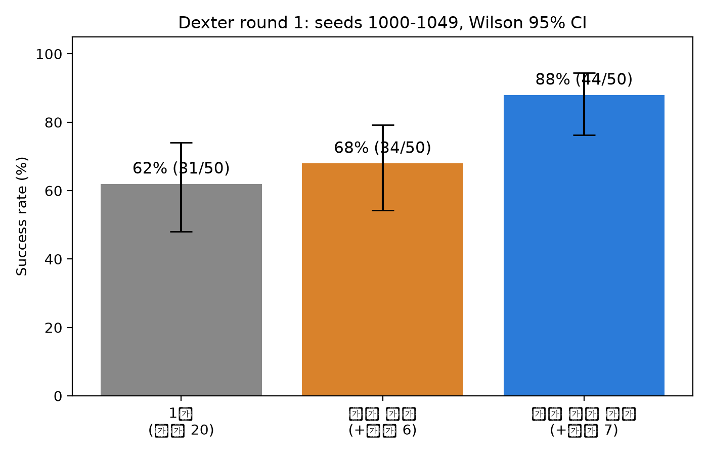

# Dexter

**브라우저에서 웹캠으로 손을 인식해 가상 로봇팔을 가르치고, 로봇이 틀리면 손으로 바로 잡아주는 시스템**

*Teach a robot arm with your bare hand in the browser, and take over the moment it goes wrong.*

> 이름의 뜻: 라틴어 dexter는 "오른손"이며 dexterity(손재주)의 어원이다. 오른손으로 로봇을 가르친다.

**질문: 로봇이 틀린 곳만 고쳐주면, 더 빨리 배울까?**

같은 사람·같은 시간(약 2분 20초)·같은 학습 조건에서 비교한 1회 결과: **기준 62% / 교정 68% / 다시 녹화(추가 시연) 88%.** 이번에는 시범을 더 보여준 쪽이 가장 높았고, 교정은 기준과 차이가 확실하지 않았다. 1회 결과라 반복이 필요하다. 자세한 내용: [docs/15-experiment-r1.md](docs/15-experiment-r1.md)



### 지금 되는 것

- **3단계 마법사 화면:** 1 녹화 → 2 학습(Colab) → 3 테스트·교정. 2단계 화면이 Colab 1번 셀에 붙여 넣을 코드(Colab 셀 생성기)와 예상 학습 시간을 만들어 준다 → [docs/10-colab.md](docs/10-colab.md)
- **학습은 Google Colab(T4)에서 한다.**

## 설치와 실행

### 필요한 환경

- Python 3.12 (`server/.venv`는 3.12.3으로 만들어져 있다. 다른 버전은 확인 필요)
- Node.js (개발 환경은 v22.23.2. 최소 버전은 확인 필요)
- **확인된 환경: Python 3.12, Node 22, 맥(arm64).** 리눅스 서버(`MUJOCO_GL=egl` 또는 `osmesa`)에서도 개발했다. 그 밖의 환경은 확인하지 않았다.
- 서버 패키지: `python3.12 -m venv server/.venv` 후 `server/.venv/bin/pip install -r server/requirements.txt`

### AUTO용 `train/.venv` 만들기

AUTO(로봇이 혼자 하기)는 서버와 따로 만든 `train/.venv`의 LeRobot으로 정책을 돌린다. 이 환경이 없으면 AUTO가 동작하지 않는다.

```bash
python3.12 -m venv train/.venv
train/.venv/bin/pip install -r train/requirements.txt
```

`train/requirements.txt`에는 `lerobot[training]==0.6.1`, `torch==2.11.0+cpu`, `numpy==2.2.6`, `mujoco==3.16.0`(평가용, `server/.venv`와 같은 버전)이 들어 있어서 mujoco를 따로 설치할 필요는 없다. 맥에서 확인된 버전은 lerobot 0.6.1, torch 2.11.0, numpy 2.2.6, mujoco 3.16.0이다. 평가를 돌릴 때는 `MUJOCO_GL=cgl`을 쓴다(맥 기준).

확인 필요: `train/requirements.txt`는 CPU용 torch 빌드(`2.11.0+cpu`, PyTorch CPU 저장소 지정)로 적혀 있다. 맥에서 이 파일 그대로 설치되는지는 확인하지 못했다. 설치가 안 되면 `+cpu`가 없는 `torch==2.11.0`으로 바꿔 시도하되, 그 방법은 검증되지 않았다.

### 저장소에 없는 파일 3개

저장소에 들어 있지 않다(`.gitignore`로 제외). 받는 방법은 **제공자에게 받기**.

| 파일 | 놓을 위치 | 용도 |
|---|---|---|
| 로봇 모델 | `third_party/mujoco_menagerie/robotstudio_so101` | SO-101 로봇 |
| 손 인식 모델 | `web/public/models/hand_landmarker.task` | 웹캠 손 인식 |
| 학습된 정책 | `checkpoints/<이름>/pretrained_model` | AUTO(로봇이 혼자 하기) |

현재 코드는 AUTO 정책 경로를 `checkpoints/dexter_act_v1/pretrained_model`로 정해 둔 상태다(`server/auto_config.py`). 그래서 `<이름>`은 `dexter_act_v1`로 놓는다. 다른 이름을 쓰는 방법은 확인 필요. AUTO는 `train/.venv`(`train/requirements.txt`)의 LeRobot을 쓰는데, 그 환경을 만드는 절차는 이 README에 아직 없다(확인 필요).

### 실행 (터미널 2개)

```bash
# 터미널 1: 서버 (맥 기준)
AUX_ENABLED=1 MUJOCO_GL=cgl server/.venv/bin/python -m server.app

# 터미널 2: 웹
cd web && npm install && npm run dev -- --host 127.0.0.1 --port 3007 --strictPort
```

브라우저에서 `http://localhost:3007`을 연다. (`AUX_ENABLED=1`은 보조 카메라 화면을 켜는 값이며, 없으면 꺼진다. 리눅스 서버에서는 `MUJOCO_GL=egl` 또는 `osmesa`를 쓴다.)

### 주의

- 녹화는 **서버가 도는 컴퓨터의 `data/raw`**에 저장된다. (손 좌표 숫자와 시뮬레이션 화면만 저장하며 웹캠 영상은 저장하지 않는다.)
- 학습은 **Google Colab**에서 한다. 웹 2단계 화면이 Colab 1번 셀 코드를 만들어 준다 → [docs/10-colab.md](docs/10-colab.md)

## 학습 (Google Colab)

학습은 내 컴퓨터가 아니라 Google Colab(T4 GPU)에서 LeRobot ACT로 한다.

1. 웹 2단계(학습) 화면에서 조건(처음 시범 / 교정 / 추가 시연)을 고르고 셀 코드를 복사한다.
2. 녹화 데이터를 학습용 데이터셋으로 변환해 tar로 묶고(방법: [docs/09-dataset.md](docs/09-dataset.md)), Google Drive의 `dexter` 폴더에 올린다.
3. Colab 노트북(`train/colab/dexter_train.ipynb`) 1번 셀에 `DATASET_TAR`, `REPO_ID`, `DATASET_ROOT` 3줄을 붙여 넣고, 셀을 **위에서부터 하나씩** 실행한다(모두 실행은 하지 않는다). 웹 화면이 만드는 코드에는 `DRIVE_DIR` 줄도 있지만 노트북 값과 같다.
4. 시간: 20,000스텝 약 47분 + 설치·확인 약 10분(T4 기준 추정치).
5. 끝나면 8번 셀로 체크포인트를 받아 `checkpoints/<이름>/pretrained_model`에 풀어 AUTO에 쓴다(현재 코드는 폴더 이름 `dexter_act_v1`로 고정).

자세한 단계: [docs/10-colab.md](docs/10-colab.md)

---

## 왜 만들었나

천안 AX 피지컬 AI 수업에서 "로봇에게 가장 어려운 일 중 하나가 수건 접기"라는 말을 들었다.
천은 잡을 때마다 모양이 바뀌어서 규칙으로 프로그래밍할 수 없다. 결국 **사람이 직접 보여주고 로봇이 따라 배우는 방식(모방학습)** 이 필요한데, 그 시연에는 조종용 로봇팔이나 VR 같은 비싼 장비가 든다. 나도 로봇팔이 없어서 시작조차 못 했다.

**누구나 웹캠만으로 로봇에게 시연을 보여줄 수 있다면**, 수건 접기 같은 어려운 일도 더 많은 사람이 가르칠 수 있다.
5주 안에 이 방식이 작동하는지 검증하려고 **블록 옮기기**부터 시작한다. 최종 목표는 수건 접기 같은 어려운 작업이다.

## 무엇이 다른가

웹캠으로 로봇을 가르치는 공개 프로젝트는 이미 있다(→ [docs/02-related-work.md](docs/02-related-work.md)). 둘 다 노트북에 설치하는 프로그램이고, 흐름이 "시연 → 학습 → 끝"이다.

| | 기존 프로젝트 | Dexter |
|---|---|---|
| 사용 방법 | 노트북에 설치 | **브라우저 링크로 접속** |
| 로봇이 실패하면 | 처음부터 시연을 더 해서 재학습 | **틀리는 순간 손을 내밀어 바로잡고, 그 순간만 학습** |
| 필요한 장비 | 웹캠 | 웹캠 |

## 어떻게 동작하나

```
[브라우저] 웹캠 + MediaPipe Hand Landmarker → 손 위치, 집기, 손바닥 제스처
     │ WebSocket
     ▼
[서버] 손 좌표 → 로봇 목표 위치 → 역기구학(mink) → MuJoCo 속 SO-101
     │ 시뮬레이션 화면은 다시 브라우저로
     ▼
[기록] LeRobot 데이터셋 형식으로 저장 (교정 구간 표시 포함)
     ▼
[학습] LeRobot ACT → 로봇이 혼자 작업 → 성공률 측정
```

1. 손으로 블록 옮기기를 20번 보여준다.
2. 그 데이터로 학습한 로봇(1호)이 혼자 해본다.
3. 틀리려는 순간 **손바닥을 보여주면** 조종권이 나에게 넘어온다. 바로잡고 **손을 내리면** 로봇이 이어서 한다. 이 교정 구간만 따로 저장된다.
4. 원래 시연 + 교정 기록으로 다시 학습한 로봇(2호)이 약했던 부분을 배운다.

## 증명할 것

같은 시간을 들였을 때 **"처음부터 다시 시연" vs "틀린 부분만 교정"** 중 어느 쪽이 성공률을 더 올리는가. 자세한 설계는 [docs/06-experiment.md](docs/06-experiment.md).

## 문서

| 파일 | 내용 |
|---|---|
| [docs/Handoff.md](docs/Handoff.md) | **현재 상태와 규칙의 원본.** 다른 문서와 다르면 이게 맞다 |
| [CLAUDE.md](CLAUDE.md) | Claude Code가 지킬 규칙 |
| [docs/01-story.md](docs/01-story.md) | 문제 정의, 발표 스토리 |
| [docs/02-related-work.md](docs/02-related-work.md) | 기존 프로젝트 비교 |
| [docs/03-plan.md](docs/03-plan.md) | 진행 순서와 단계별 완료 기준 |
| [docs/04-architecture.md](docs/04-architecture.md) | 구조, 데이터 형식, 교정 모드 |
| [docs/05-server-setup.md](docs/05-server-setup.md) | dev-server-01 설정 |
| [docs/06-experiment.md](docs/06-experiment.md) | 실험 설계와 측정 |
| [docs/10-colab.md](docs/10-colab.md) | Colab 학습 절차, 웹 2단계 셀 생성기 |
| [docs/15-experiment-r1.md](docs/15-experiment-r1.md) | 1회차 실험 결과(교정 vs 추가 시연) |
| [prompts/](prompts/) | 웹 Claude, Claude Code에 붙여 넣을 요청문 |

## 기술 스택

React + Vite, MediaPipe Tasks(Hand Landmarker), FastAPI + WebSocket, MuJoCo, mink, LeRobot(ACT)

## 출처

- SO-101 모델: [MuJoCo Menagerie](https://github.com/google-deepmind/mujoco_menagerie) `robotstudio_so101` (Apache-2.0)
- 손 추적: [MediaPipe](https://github.com/google-ai-edge/mediapipe) Hand Landmarker (Apache-2.0)
- 학습: [LeRobot](https://github.com/huggingface/lerobot) ACT (Apache-2.0)
- 역기구학: [mink](https://github.com/kevinzakka/mink)
