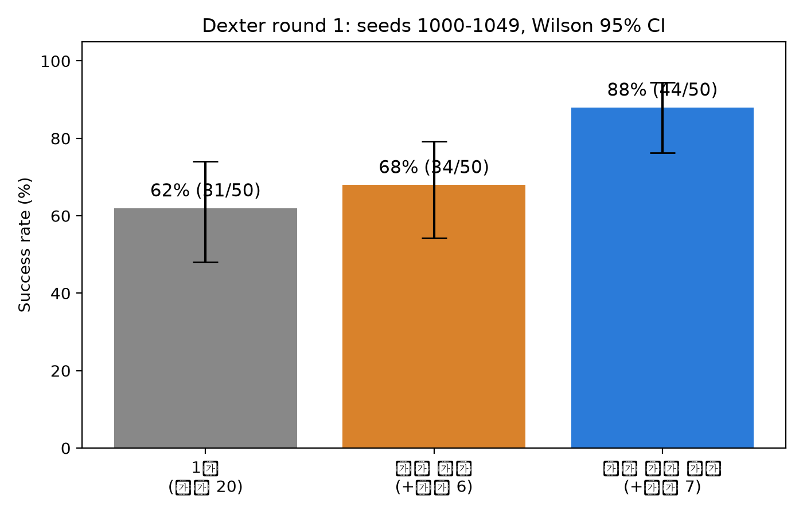

# 15. 1회차 실험 결과: 교정(HG-DAgger) vs 추가 시연

## 목적
같은 사람 시간을 쓸 때, "로봇이 틀린 구간만 교정"과 "처음부터 추가 시연" 중 어느 쪽이 성공률을 더 올리는지 비교한다.

## 설정
- 환경: 맥북(arm64), MuJoCo 3.16.0, 렌더 `MUJOCO_GL=cgl`, 평가 `--device cpu`
- 기반: 1호 시연 20개로 학습한 ACT 정책(20,000스텝)
- 교정 조건: 시드 28~39에서 AUTO 실행 중 Space로 넘겨받아 교정. 저장 6개(시드 28, 29, 30, 33, 38, 39), 사람 시간 합계 142.5초. 학습 데이터 = 1호 시연 20 + 교정 HUMAN 구간 6 (26 에피소드, 17,942 프레임)
- 추가 시연 조건: 시드 45~53 중 AUTO 없이 직접 조종한 성공 7개, 합계 약 140.4초. 학습 데이터 = 1호 시연 20 + 새 시연 7 (27 에피소드, 17,880 프레임)
- 학습: Colab T4, 20,000스텝, batch 8, 시드 1000 (두 조건 동일)
- 평가: 시드 1000~1049(학습·교정에 사용하지 않음) 50개, 최대 45초

## 결과
| 모델 | 성공 | 성공률 | Wilson 95% | 집기 실패 |
|---|---|---|---|---|
| 1호 (시연 20) | 31/50 | 62.0% | 48.1~74.1% | 19 |
| 교정 조건 | 34/50 | 68.0% | 54.2~79.2% | 16 |
| 추가 시연 조건 | 44/50 | 88.0% | 76.2~94.4% | 6 |

참고: 1호는 천안 서버에서 29/50(58.0%)였고, 맥북에서 31/50(62.0%)로 거의 같았다.

## 해석과 한계
- 1회차에서는 추가 시연이 교정보다 높았다. 가설("교정이 더 효율적")을 지지하지 않는 결과이며 그대로 보고한다.
- 교정(68%)과 1호(62%)의 구간은 크게 겹쳐 차이를 확정할 수 없다.
- 교정 데이터는 틀린 순간 이후만 담아 접근·집기 시작 동작이 적고, 일부 구간은 매우 짧다(시드 38은 1.5초). 일부 교정은 조종이 끊기는 환경에서 녹화했다.
- 시드 34, 36, 37은 AUTO가 이미 성공해 교정이 없었다.
- 1회차 1번뿐이라 학습 시드에 따른 변동을 모른다. 2회차(교정 52~63, 추가 시연 64~75)는 향후 과제다.
- 파이프라인 시험(교정 4개)은 별도이며 본 결과가 아니다.

## 재현
1. 교정 프레임: `server.render_correction_frames`, 교정 데이터셋: `train/build_correction_dataset.py` (`--exclude-corrections 6`)
2. 추가 시연 프레임: `server.render_frames --episodes ...`, 데이터셋: `train/build_dataset.py`
3. tar: `COPYFILE_DISABLE=1 tar -cf` → Drive 업로드 → `train/colab/dexter_train.ipynb` (1번 셀 3줄만 변경)
4. 평가: `train/evaluate.py --policy act --checkpoint <경로> --seed-start 1000 --n 50 --device cpu`

데이터와 체크포인트는 용량 때문에 저장소에 포함하지 않는다.
